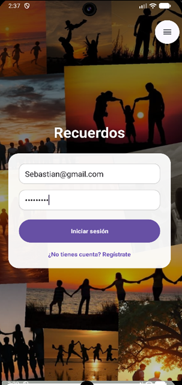
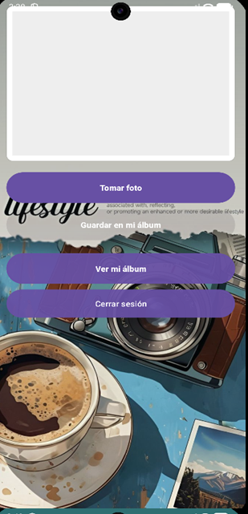
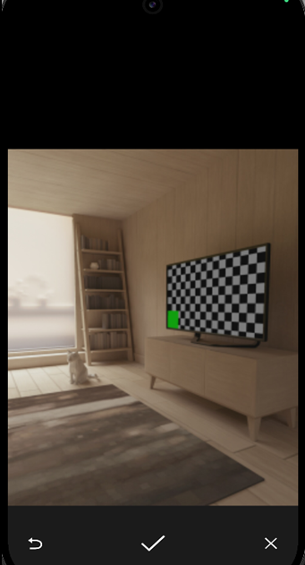
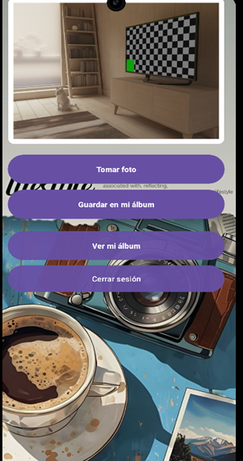
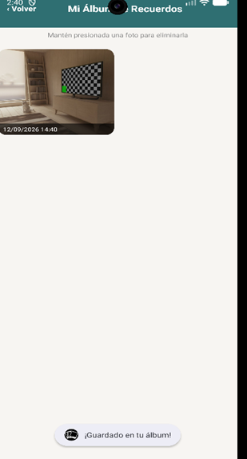

# Piero Sebastián Mancilla Ularte

Estudiante de Ingeniería de Software con enfoque en Inteligencia Artificial (SENATI, V semestre). Este portafolio reúne los proyectos desarrollados durante mi formación y mi práctica profesional.

📧 piero.mancilla.ularte@gmail.com
🔗 LinkedIn: *(agregar enlace cuando esté listo)*

---

## 📱 Álbum de Recuerdos

Aplicación Android para la gestión de álbumes de fotos personales.

**Tecnologías:** Java, Android Studio, Firebase Authentication, Cloud Firestore

**Funcionalidades principales:**
- Inicio de sesión con correo y contraseña (Firebase Authentication)
- Captura de fotos desde la cámara del dispositivo
- Almacenamiento de fotos en Cloud Firestore
- Visualización en cuadrícula (RecyclerView) con opción de eliminar manteniendo presionada una foto

**Capturas:**

**Descarga:**

Escanea este código QR para descargar el APK (distribución vía Diawi):

---

## 🍦 Marcador de Asistencias — Frio Star

Sistema desarrollado durante mi práctica en la empresa Frio Star para el registro y control de la asistencia del personal.

**Tecnologías:** Python, Visual Studio Code, base de datos SQL

**Descripción:**
Sistema interno para registrar y dar seguimiento a la asistencia de los trabajadores, reemplazando un proceso que antes se llevaba de forma manual.

> *No se incluyen capturas ni código de este proyecto por tratarse de un desarrollo interno de la empresa.*

---

## 🛠️ Habilidades técnicas

- **Lenguajes:** Python, Java
- **Entornos de desarrollo:** Android Studio, Visual Studio Code
- **Backend / Base de datos:** Firebase, SQL
- **Herramientas de IA aplicadas al desarrollo:** Claude, Grok
